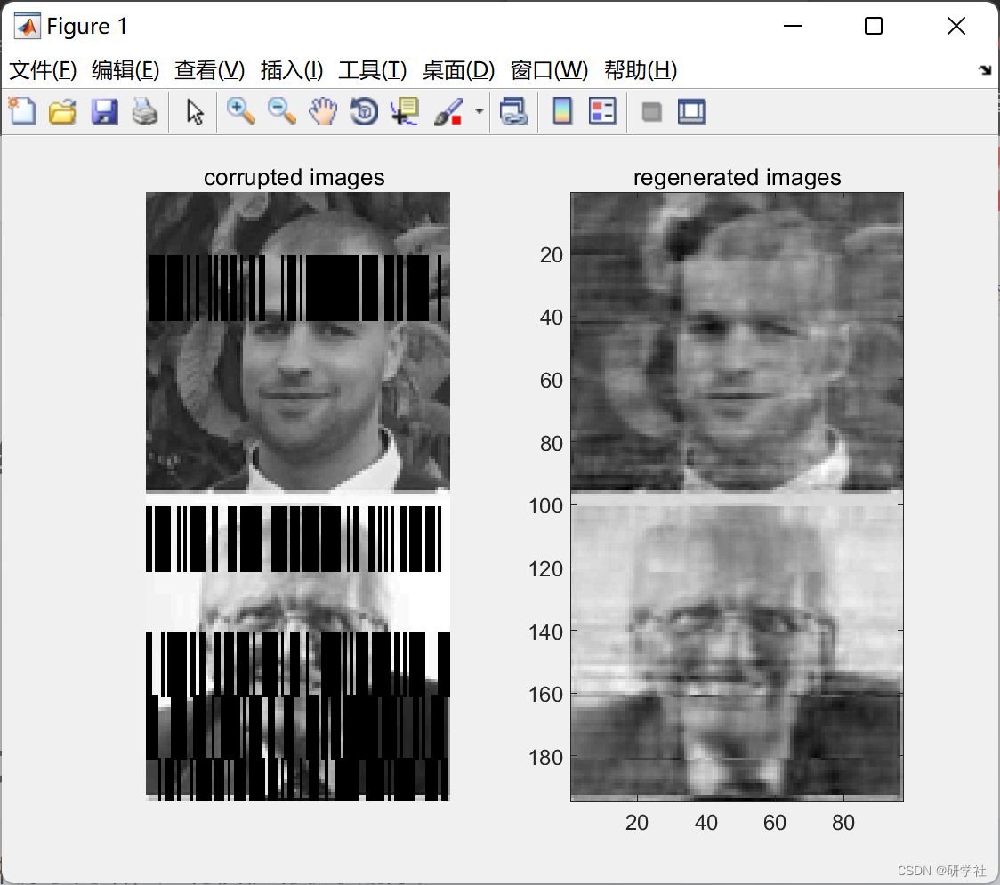

# Research on Image Denoising Algorithm Based on Sparse Constraints (Matlab Code Implementation)

💥💥💞💞 Welcome to this blog❤️❤️💥💥
🏆 Bloggers' Advantages: 🌞🌞🌞 The content of the blog strives for rigorous thinking and clear logic, facilitating readers.
⛳️ Mantra: A journey of a thousand miles is begun with a single step. 1 Overview📚2 Running Results🎉3 References🌈4 MATLAB Code Implementation
💥1 Overview Image data is indispensable in daily communication and exchange. However, during transmission and reception processes, image noise often interferes due to hardware devices, degrading image quality and affecting subsequent image processing and analysis. Therefore, removing image noise is crucial. Currently, how to remove noise while preserving image texture details remains an urgent problem to be solved. In recent years, the rise of sparse representation theory has made significant breakthroughs in image denoising.
📚2 Running Results​Edit
Part of the code:
pathname = uigetdir;
allfiles = dir(fullfile(pathname, '*.jpg'));
xts = []; % initialize testing inputs
for i = 1:size(allfiles, 1)
x = imread([pathname '\\' allfiles(i).name]);
x = imresize(x, gamma);
x = rgb2gray(x);
x = double(x);
xts = [xts; x];% testing set building
end
%% Initialization of the Algorithm
NumberofHiddenNeurons = 500; % number of neurons
D_ratio=0.35;       % the ratio of noise in each chosen frame  
DB=1;           % the power of white gaussian noise in decibels  
ActivationFunction='sig'; % Activation function  
frame=20;         % size of each frame  
%% Train and test  
%%  
%  
% During training, gaussian white noise and zeros will be added to  
% randomly chosen frames .  
% The Autoencoder will be trained to avoide this type of data corruption.  
[AE_net]=elm_AE(xtr,xts,NumberofHiddenNeurons,ActivationFunction,D_ratio,DB,frame)  
%% Important Note:  
%%  
%  
% After completing the training process,we will no longer in need To use  
% InputWeight for mapping the inputs to the hidden layer, and instead of  
% that we will use the Outputweights beta for coding and decoding phases  
% and also we can't use the activation functon because beta is coputed  
% after the activation .  
% The same thing is applied on biases (please for more details check the  
% function'ELM_AE' at the testing phase).  
%% Illustration  
subplot(121)  
corrupted=AE_net.x(:,1:gamma(2)*2);  
imshow(corrupted')  
title('corrupted images ');  
subplot(122)  
regenerated=AE_net.Ytr_hat(:,1:gamma(2)*2);  
imagesc(regenerated'), colormap('gray');  
title('regenerated images');  
%% scale training dataset  
T=Tinputs';T = scaledata(T,0,1);% memorize originale copy of the input and use it as a target  
P=Tinputs';  
%% scale training dataset  
TV.T=Tsinputs';TV.T = scaledata(TV.T,0,1);% memorize originale copy of the input and use it as a target  
TV.P=Tsinputs';TV.P = scaledata(TV.P,0,1);% temporal input  
TVT=TV.T;%save acopy as an output of the function  
%% in the 1st and 2nd step we will corrupte the temporal input  
PtNoise=zeros(size(P));  
i=1;  
while i < size(P,2)-frame  
gen=randi([0,1],1,1);  
PNoise=[];  
%%% 1st step: generate set of indexes to set some input's values to zero later  
%%% (here we set them randomly and you can choose them by probability)%%%  
[zeroind] = dividerand(size(P,1),1-D_ratio,0,D_ratio);% generate indexes  
%%% 2nd step: add gaussian noise  
if gen==1  
Noise=wgn(1,size(P,1),DB)';% generate white gaussian noise  
else  
Noise=zeros(1,size(P,1))';  
end  
for j=1:frame;%copy noise  
PNoise=[PNoise Noise];  
end  
if gen==1  
for j=1:length(zeroind);% set to zero  
PNoise(zeroind(j),:)=0;  
P(zeroind(j),i:i+frame)=0;  
end  
end  
PtNoise(:,i:i+frame-1)=PNoise;  
i=i+frame;  
end  
🎉3 References

## Images

<!-- PAYMENT_BLOCK -->

## Get this dataset

- Payment link (Stripe): [Buy now](https://buy.stripe.com/3cs8yP7sY87d0vu9AB)
- Payment QR code: 

<!-- /PAYMENT_BLOCK -->
